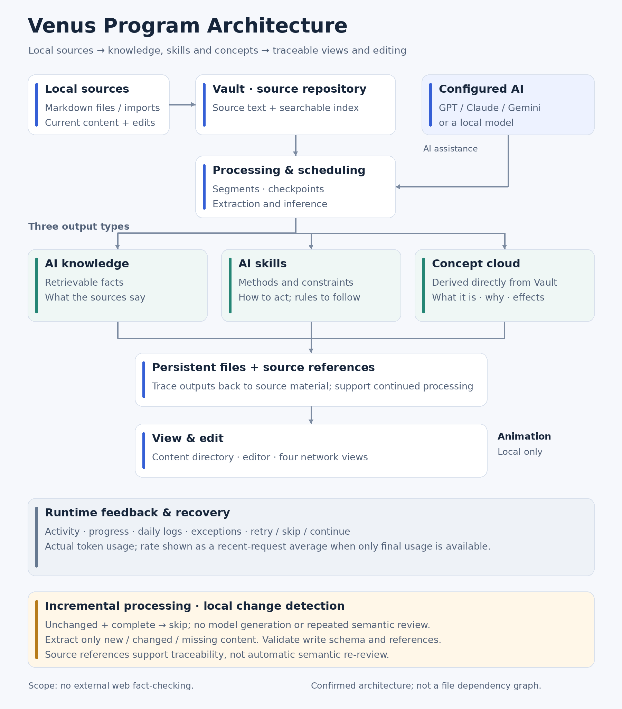

# Venus program architecture

[Scalable SVG](images/venus-architecture-en.svg)

Local Markdown and imports enter Vault, where current text and user edits provide the effective analysis input. Configured AI providers support segmented extraction with checkpoints. AI knowledge, AI skills and the concept cloud persist with source references and appear in readable content directories, editing tools and four network views. Animation runs locally.

Incremental local change detection skips unchanged completed ranges, including valid empty results. Only new, changed or missing ranges need extraction. Schema and current-version reference checks protect writes; references do not create semantic re-review tasks. Venus does not consult older conversations to verify truth or override current user edits. Imported instructions do not grant authority to execute them.

Runtime feedback shows actual activity, saved progress, daily logs and recoverable exceptions. Usage counters come from real provider receipts. With terminal-only usage, speed is the latest request's end-to-end average output tokens per second, including startup, waiting and transport. Cache subsets are not added twice, and missing counters are not invented.

This is a program architecture illustration, not a file dependency graph or an external web fact-checking service. See [the detailed update notes](../UPDATE-NOTES-2026-10-19.md) for scope and validation.

## 0.6.0 organization and display path

Saved project identity, source mapping and explicit branch lineage feed one project-membership model for the knowledge directory and network. Project primaries contain content subcategories, while general topics remain cross-project filters. Manual ownership wins over inherited metadata; ambiguous identity remains unassigned. This derives display organization without deleting or merging source Markdown.

The complete node/edge store remains available for retrieval. A branch-visibility stage selects actual rendered instances and active orbit bodies. Overview keeps category roots and loose nodes; explicit selection or locate expands a branch. Hidden orbital clocks, positions, collision bodies and shared tours stop advancing. Clearing selection collapses; zoom does not expand. Pause state is preserved and hidden time is not caught up.

Overview aggregate size counts unique contained content IDs and maps volume to radius through a cube root, without the detail cap. Expanded detail uses the original sizing function and cap. UI-time appearance transitions are separate from orbital time. Display-only radius never enters physical orbit, collision or camera-fit calculations.

All four networks map activity evidence to the same thirteen stable color tiers in both server-derived heat and browser legends. Content tiers retain cited turns, active days and independent source reuse as evidence. Main-category labels use the same palette with unique-membership thresholds of 0, 2, 3, 5, 10, 16, 25, 32, 40, 45, 50, 75 and 100. Explicit priority projects map to gold. Orbital depth, spacing, sizing and visibility rules are unchanged. The diagram above retains the same source/processing/storage/view architecture; this section specifies the updated organization and rendering stages. [The 0.6.0 screenshots](SCREENSHOTS-0.6.0.md) document the earlier views, before the shared-palette update.
