# Venus 0.6.0 — synthetic English screenshots

These are actual browser captures from an isolated local demo with English synthetic content and metadata. No private source material, private project identifiers or real usage receipts are shown. No live AI analysis ran. The development footer reads 0.3.6; the captures show the 0.6.0 feature delta before public packaging.

[Capture receipt](images/0.6.0/screenshot-receipt.json) · [Screenshot ZIP](https://github.com/shenhang24/venus/releases/download/v0.6.0/Venus-English-Screenshots.zip)

### Vault sources

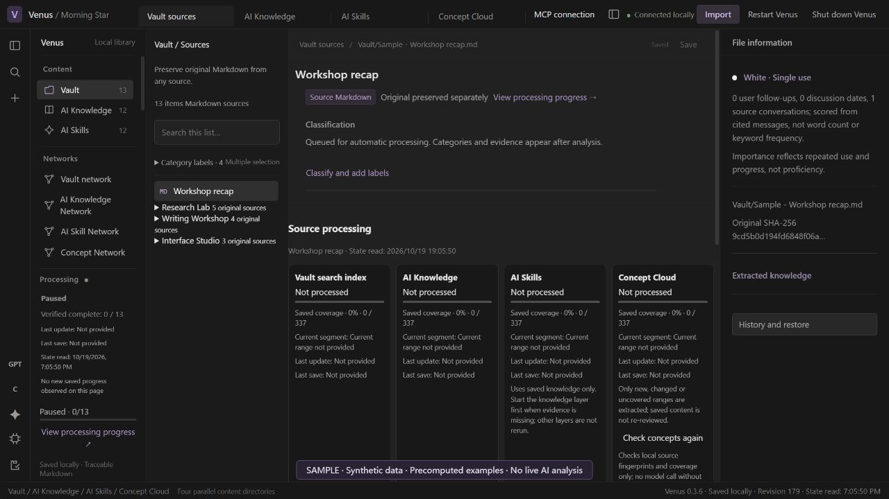

### Ai knowledge projects

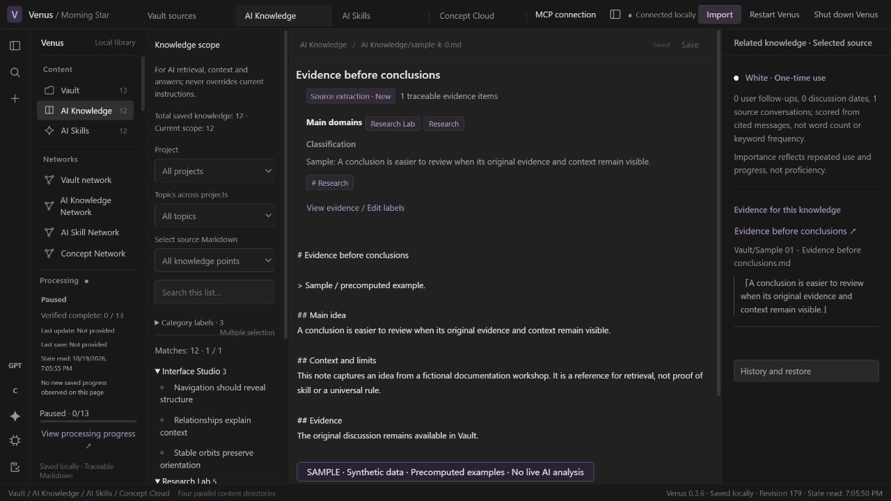

### Ai skills

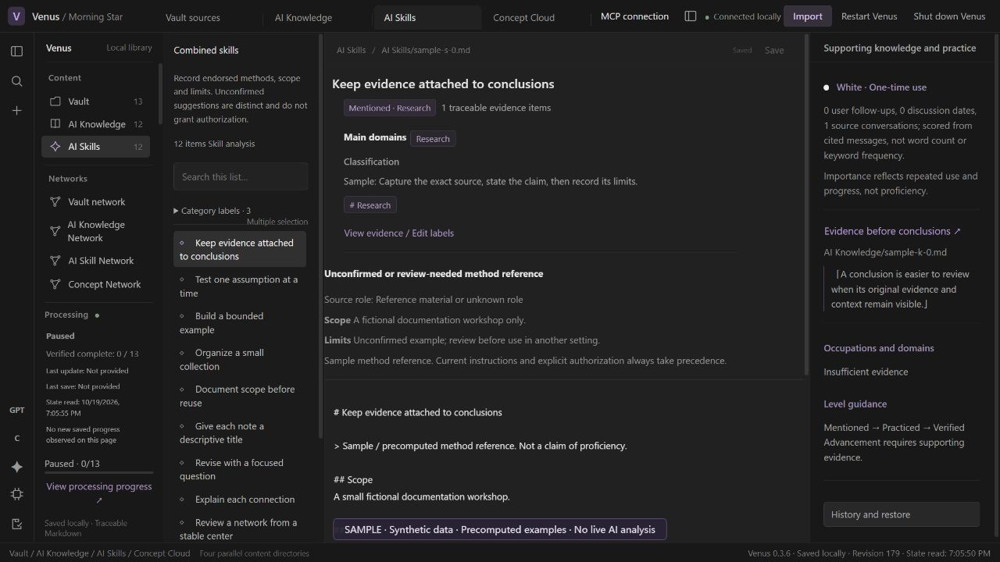

### Concept cloud

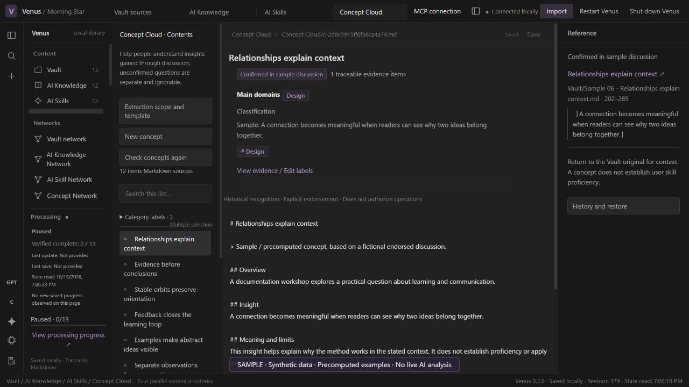

### Vault network overview

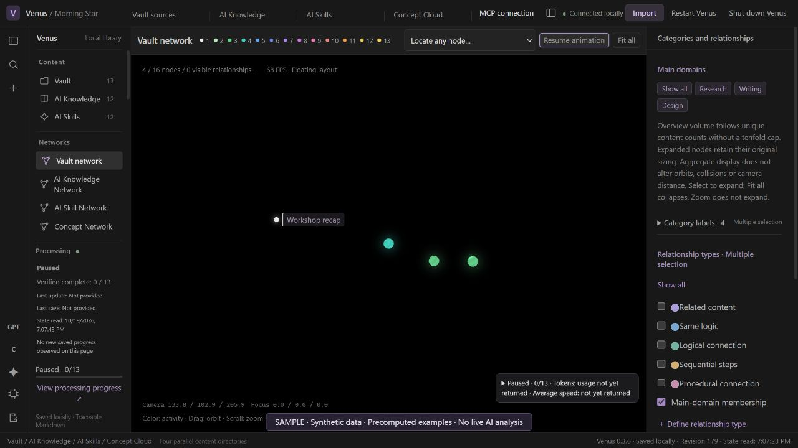

### Knowledge network overview

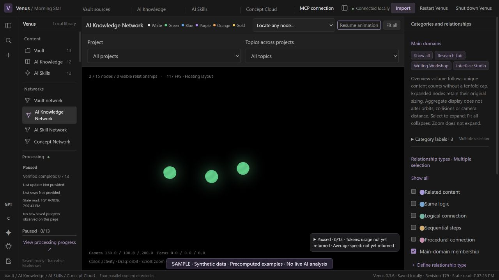

### Knowledge network expanded

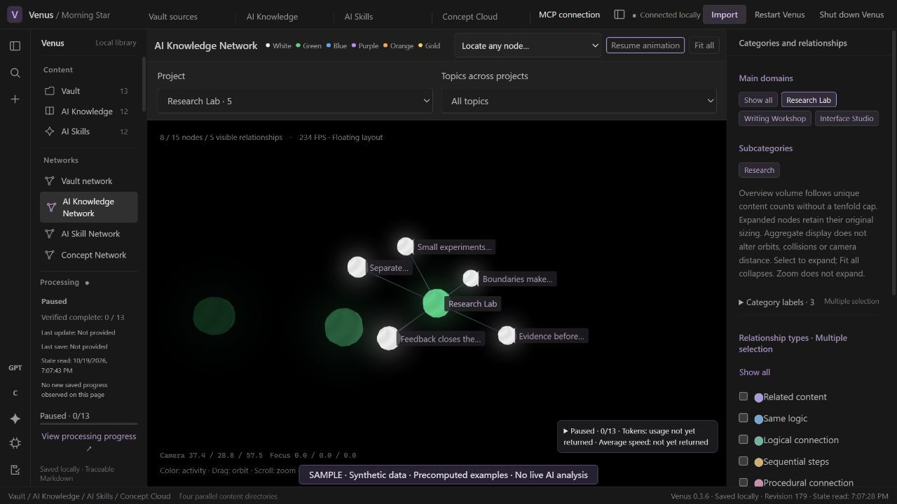

### Skill network overview

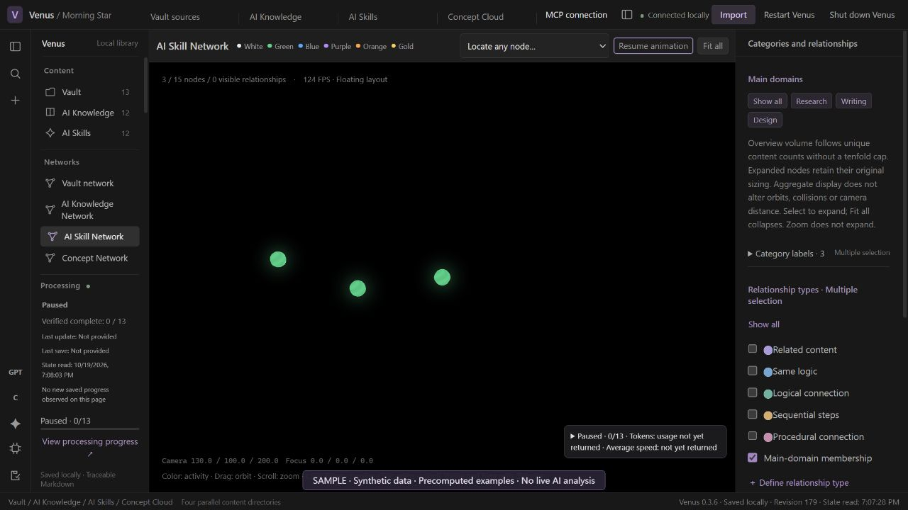

### Concept network overview

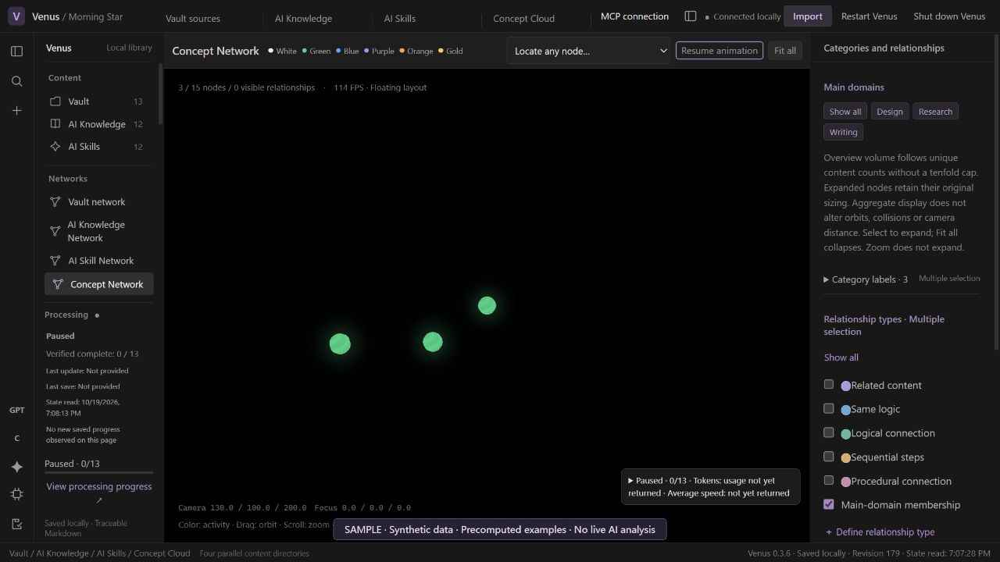

### Vault network expanded

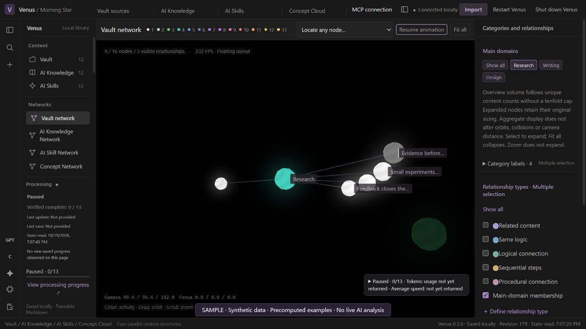

### Skill network expanded

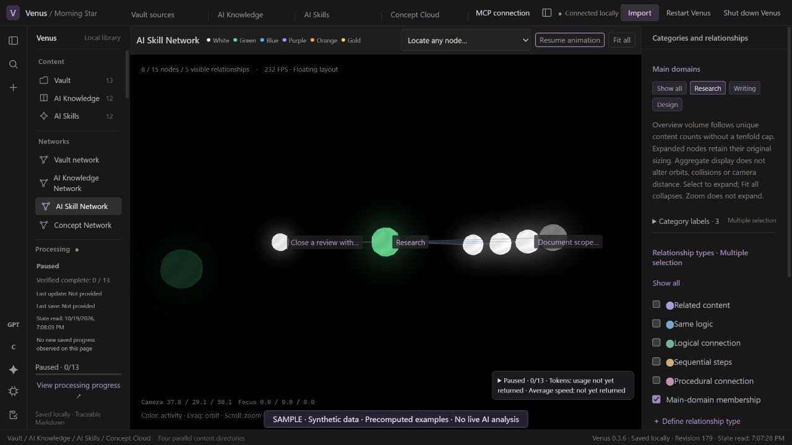

### Concept network expanded

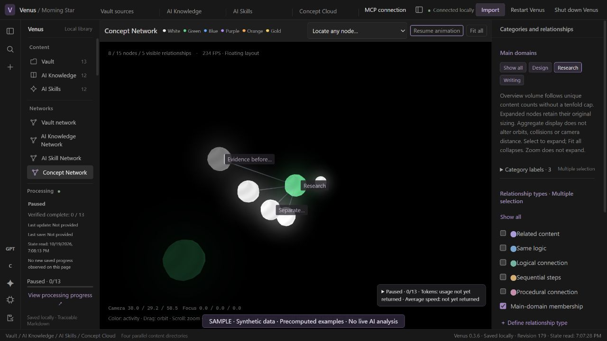

### Logs updates

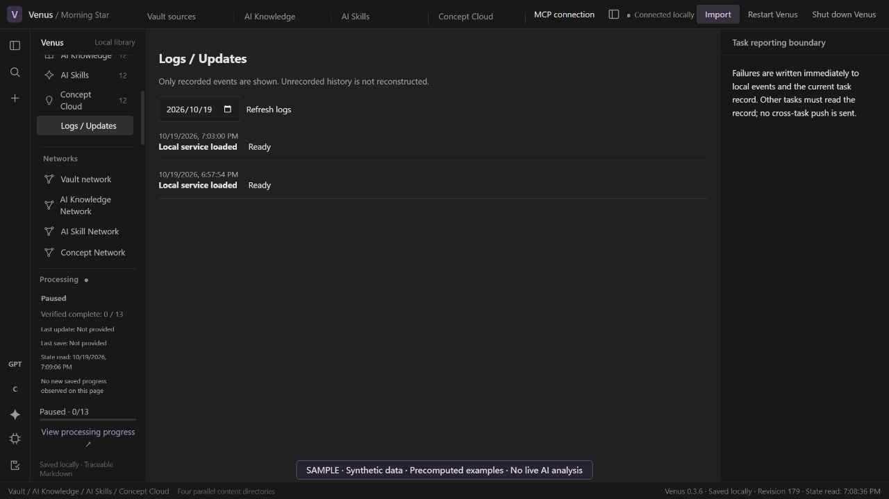

### Import

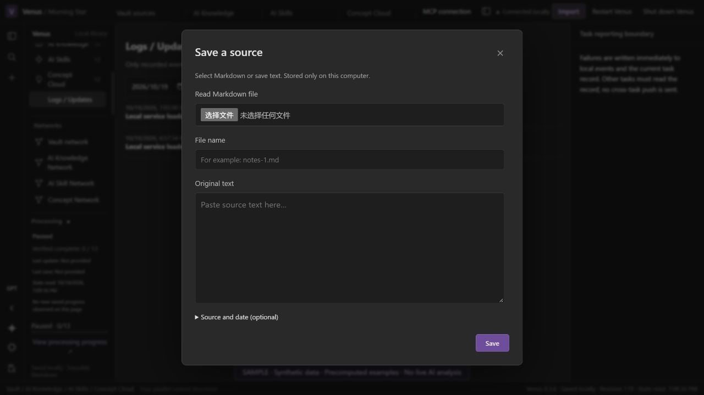

### Mcp connection

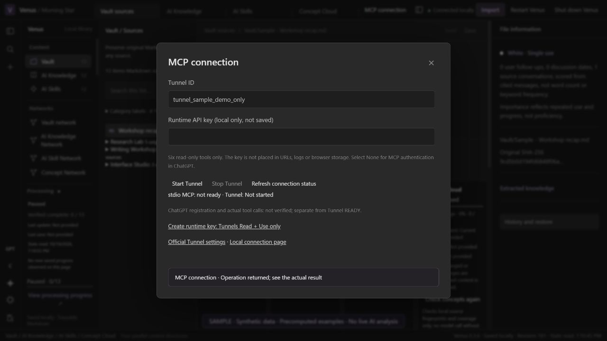
